# PaDiM Anomaly Detection on MVTec AD

An end-to-end anomaly detection and defect localization pipeline for all **15 MVTec AD categories**. It uses a frozen ImageNet-pretrained ResNet18 backbone and fits separate PaDiM Gaussian statistics for each category.

PaDiM fits the distributions of normal patch features; it does not fine-tune the backbone. The category must be supplied at inference time. Predictions are **normal/anomaly**, rather than named defect classes.

## Method and experiment settings

| Component | Setting |
|---|---|
| Dataset | MVTec AD, 15 categories |
| Split | Approximately 80%/20% of official normal training images for fitting/validation; seed 42 |
| Test set | Complete official test set; excluded from fitting and threshold calibration |
| Preprocessing | RGB, 224 × 224, ImageNet normalization |
| Training augmentation | On-the-fly brightness and contrast factors 0.9–1.1; one pass per image |
| Validation/test augmentation | None |
| Backbone | Frozen ResNet18, ImageNet pretrained |
| Features | layer1/layer2/layer3: 448 combined channels, 100 selected channels |
| Patch grid | 56 × 56 |
| Statistical model | Per-patch mean and regularized covariance; regularization 0.01 |
| Scoring | Mahalanobis distance, bilinear upsampling, Gaussian smoothing (sigma 4) |
| Image score | Maximum smoothed pixel score |
| Calibration | Normal-validation image quantile 0.95 and pixel quantile 0.995 |
| Prediction rule | Score strictly greater than the applicable threshold |
| Execution used | Apple MPS for backbone features; CPU for Gaussian statistics/scoring |

Dataset integrity checks reported **6,612 readable images and masks**, zero missing mask pairs, and zero image/mask dimension issues. Split and preprocessing checks passed for all categories.

## Repository contents

| Path | Purpose |
|---|---|
| `dataset_checks/` | Dataset count, pairing, readability, and dimension checks |
| `scripts/create_splits.py` | Reproducible train/validation/test CSV manifests |
| `scripts/prepare_readme_images.py` | Copies one existing defect visualization per category into the README gallery |
| `src/mvtec_dataset.py` | Image and mask preprocessing |
| `src/augmented_dataset.py` | Training-only augmentation |
| `src/padim_features.py` | Frozen multiscale feature extraction |
| `src/fit_padim.py` | Per-category Gaussian fitting |
| `src/padim_inference.py` | Shared inference and scoring |
| `src/calibrate_padim.py` | Normal-validation threshold calibration |
| `src/evaluate_padim.py` | Official test evaluation and charts |
| `src/visualize.py` | Boundary visualization entry point, as named in this project |
| `splits/` | 45 CSV manifests and split summary; paths relative to data root |
| `results/calibration/` | Threshold JSON files and calibration summary |
| `results/evaluation/` | Metrics, prediction CSVs, and charts |
| `results/visualizations/` | Boundary visualization panels for all categories |
| `docs/examples/` | One selected visualization per category for this README |

**The original dataset in `data/` and fitted checkpoints in `models/` are excluded from Git.** Calibration score arrays, environments, and caches are also ignored. CSV manifests contain paths and labels, not image data. Result panels and charts remain included.

## Run the pipeline

Run commands from the project root using the existing `cv` environment:

```bash
conda activate cv
python -m pip install torch torchvision Pillow numpy scipy scikit-learn matplotlib
```

This installs dependencies without pinning versions. For exact environment capture, export the versions used for your run before reproducing it elsewhere.

Place the downloaded dataset under `data/`, with each category containing `train/good/`, `test/`, and `ground_truth/`. The repository does not download or include the dataset.

### 1. Create splits

```bash
python scripts/create_splits.py --data-root data --output-dir splits --seed 42
```

### 2. Check preprocessing, augmentation, and features

```bash
python src/mvtec_dataset.py --data-root data --splits-dir splits --category all
python src/augmented_dataset.py --data-root data --splits-dir splits --seed 42
python src/padim_features.py --data-root data --splits-dir splits --device mps
```

The first feature extraction run downloads ImageNet pretrained weights.

### 3. Fit, calibrate, and evaluate

```bash
python src/fit_padim.py --data-root data --splits-dir splits --output-dir models --category all --device mps
python src/calibrate_padim.py --data-root data --splits-dir splits --models-dir models --device mps
python src/evaluate_padim.py --data-root data --splits-dir splits --models-dir models --calibration-dir results/calibration --device mps
```

Fitting refuses to overwrite existing checkpoints unless `--overwrite` is supplied. Each checkpoint is approximately 120.8 MiB. Calibration JSONs are bound to the fitted checkpoint hash; recalibrate and reevaluate after refitting.

Use `--device cpu` or `--device cuda` on other hardware. Exact numerical reproducibility across devices is not guaranteed.

### 4. Generate boundary panels and prepare the README gallery

The boundary renderer is named `visualize.py` in this project. Explicitly set the output directory so newly generated panels use the renamed folder:

```bash
python src/visualize.py --data-root data --splits-dir splits --models-dir models --device mps --output-dir results/visualizations
python scripts/prepare_readme_images.py
```

If the boundary renderer retains its original filename, substitute `src/visualize_padim_boundaries.py` in the first command. If the panels already exist, run only the second command.

The gallery helper selects the alphabetically first existing defect panel in each category, without selecting by prediction success. It copies images without changing the original results and records the source filenames in `docs/examples/selection.csv`.

## Test results

Results below are from the completed run with the settings above, rounded to four decimals. Macro image AUROC: **0.9017**. Macro pixel AUROC: **0.9672**. Macro values give each category equal weight.

| Category | Image AUROC | Accuracy | Image F1 | Pixel AUROC | Dice | IoU |
|---|---:|---:|---:|---:|---:|---:|
| bottle | 0.9984 | 0.9880 | 0.9921 | 0.9824 | 0.5642 | 0.3929 |
| cable | 0.8356 | 0.6133 | 0.5538 | 0.9647 | 0.4043 | 0.2534 |
| capsule | 0.8608 | 0.6515 | 0.7416 | 0.9837 | 0.2918 | 0.1708 |
| carpet | 0.9827 | 0.9487 | 0.9659 | 0.9880 | 0.4147 | 0.2616 |
| grid | 0.9231 | 0.7949 | 0.8367 | 0.9207 | 0.3073 | 0.1816 |
| hazelnut | 0.8554 | 0.8091 | 0.8552 | 0.9819 | 0.5785 | 0.4069 |
| leather | 1.0000 | 0.9677 | 0.9787 | 0.9914 | 0.0826 | 0.0431 |
| metal_nut | 0.9785 | 0.9304 | 0.9579 | 0.9676 | 0.7509 | 0.6011 |
| pill | 0.8153 | 0.3593 | 0.3886 | 0.9529 | 0.5134 | 0.3453 |
| screw | 0.6965 | 0.5375 | 0.5843 | 0.9799 | 0.1533 | 0.0830 |
| tile | 0.9513 | 0.8034 | 0.8435 | 0.9185 | 0.4784 | 0.3144 |
| toothbrush | 0.8500 | 0.9048 | 0.9375 | 0.9868 | 0.3403 | 0.2050 |
| transistor | 0.8887 | 0.7900 | 0.6557 | 0.9716 | 0.5790 | 0.4075 |
| wood | 0.9754 | 0.9114 | 0.9402 | 0.9355 | 0.3857 | 0.2389 |
| zipper | 0.9133 | 0.8609 | 0.9067 | 0.9831 | 0.4415 | 0.2833 |

Pixel metrics aggregate all test pixels within each category at **224 × 224**, including normal images. Dice and IoU use the fixed pixel threshold. High AUROC does not necessarily imply accurate thresholded masks: leather, for example, has pixel AUROC 0.9914 but Dice 0.0826. Pill and screw also show weak image classification at the current operating settings.

Threshold quantiles are empirical estimates from small normal validation sets; future false-positive rates are not guaranteed. Brightness/contrast augmentation may affect sensitivity to color defects. These are initial project results, not claims of reproducing the original paper's benchmark. Any subsequent tuning should use training/validation data; repeated decisions based on these test results would make them exploratory.

The accuracy chart is saved at `results/evaluation/charts/accuracy_by_category.png`. Per-category ROC, precision–recall, and confusion-matrix panels are saved alongside it.

## Visualization gallery

One existing defect visualization per category. Each panel compares the input, predicted defect boundaries, anomaly heatmap, and ground-truth mask.

Red contours follow the thresholded **predicted** mask, not the ground truth. Small components are filtered for display (default minimum area: 16 pixels); this does not change evaluation metrics. Image decisions and contours use separate thresholds, so a normal image decision can coexist with a predicted contour. Scores are raw distances, not confidence percentages. Category test accuracy is a dataset-level metric.

### bottle

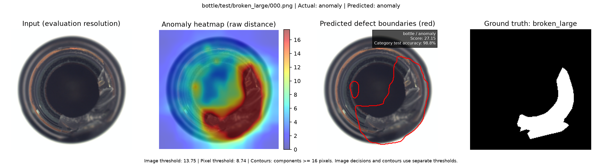

### cable

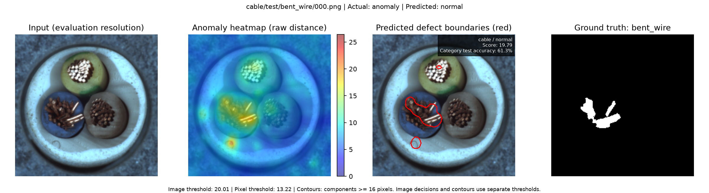

### capsule

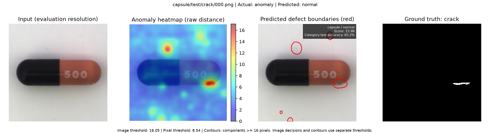

### carpet

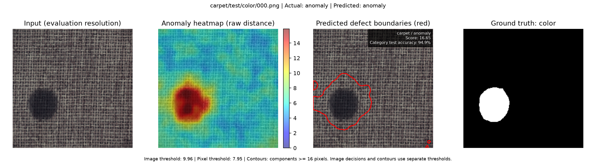

### grid

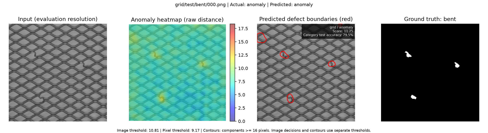

### hazelnut

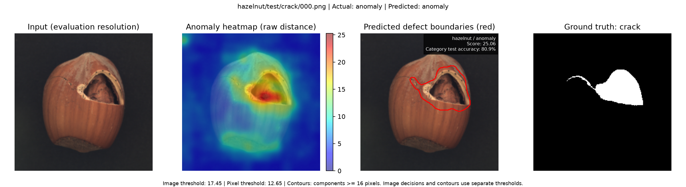

### leather

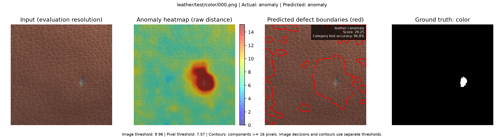

### metal nut

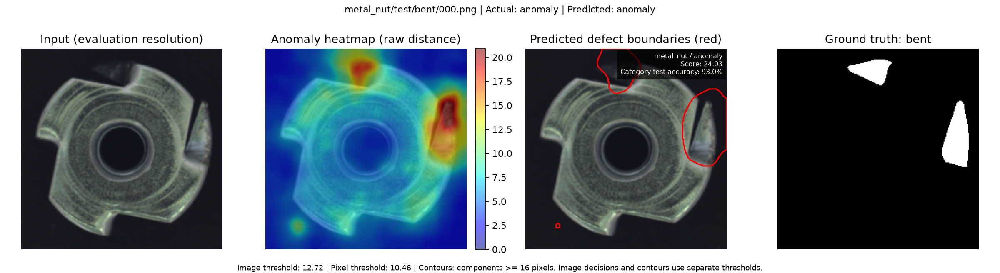

### pill

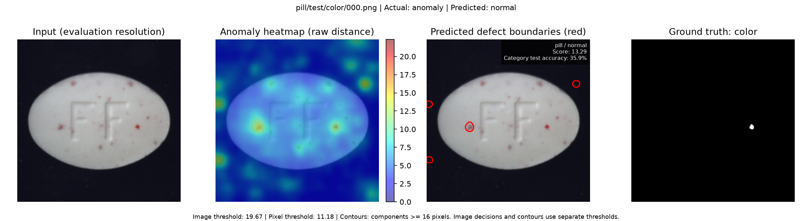

### screw

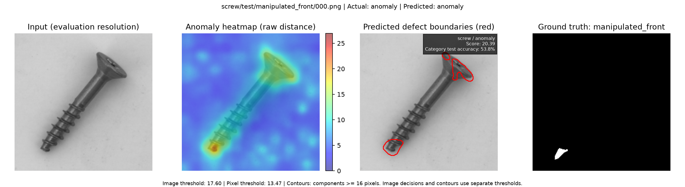

### tile

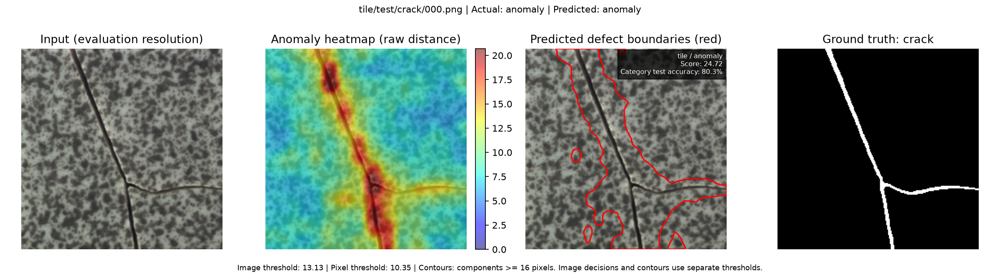

### toothbrush

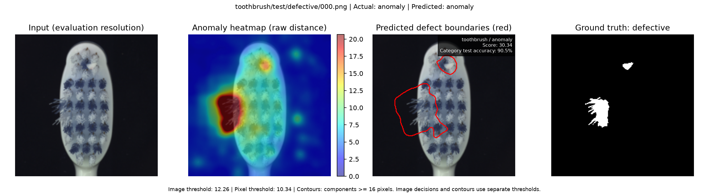

### transistor

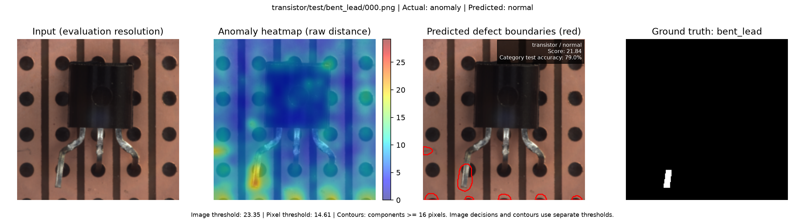

### wood

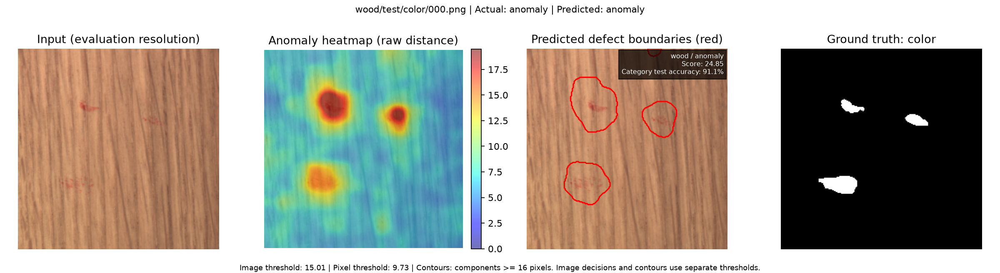

### zipper

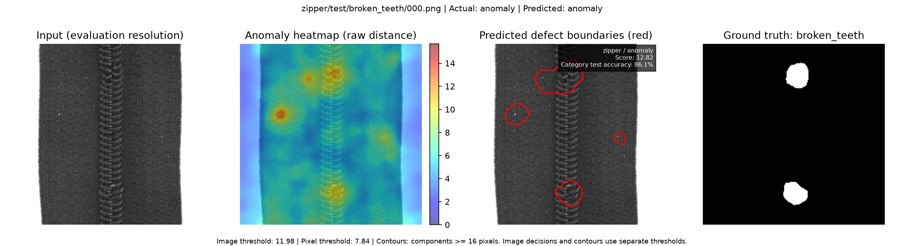

## Attribution

The visualization panels contain images derived from **MVTec AD**, copyright 2019 MVTec Software GmbH. The supplied dataset README specifies **Creative Commons Attribution-NonCommercial-ShareAlike 4.0 International**. The original data is not bundled here; dataset-derived example panels retain that attribution and license. This README does not assign a license to the source code.

Dataset reference: Paul Bergmann, Michael Fauser, David Sattlegger, and Carsten Steger, *A Comprehensive Real-World Dataset for Unsupervised Anomaly Detection*, CVPR 2019.

Method reference: Thomas Defard, Aleksandr Setkov, Angelique Loesch, and Romaric Audigier, *PaDiM: a Patch Distribution Modeling Framework for Anomaly Detection and Localization*.

